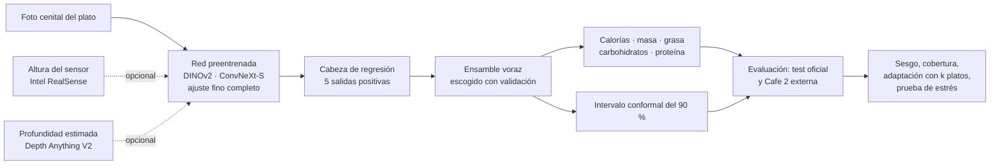

# Calorías de un plato a partir de una foto

Redes preentrenadas, margen de error y prueba en una cafetería no vista (Nutrition5k).

**Autor:** Matías Martínez Moreno

## La idea

Calcular las calorías de un plato a ojo falla mucho: en el estudio de Nutrition5k, personas sin formación se equivocaron 53 % al estimar la masa y nutricionistas, 41 %. Las apps de celular tampoco lo resuelven; un estudio del NIH (resultados preliminares, NUTRITION 2026) encontró que cuatro apps comerciales subestimaron las calorías en cerca de un tercio.

Este proyecto entrena redes que miran la foto de un plato, tomada desde arriba, y estiman **calorías, masa, grasa, carbohidratos y proteína**, cada una con un intervalo del 90 %. Parte de un resultado publicado (Thames et al., 2021), usa redes preentrenadas y se prueba en una muestra externa: 238 platos de una segunda cafetería que el trabajo original no usó.

## Preguntas

1. **¿Se confirma el resultado publicado?** Con el mismo protocolo y la misma métrica, ¿se alcanza o supera el error de los trabajos previos?
2. **¿Se aporta algo?** ¿Qué agrega cada componente (receta, profundidad medida o estimada, ensamble, más entrenamiento) y qué diferencias son reales y no ruido?
3. **¿Qué tan confiable es?** ¿Cuánto error, sesgo y cobertura de intervalos hay en otra cafetería, y cuántos platos pesados del lugar nuevo hacen falta para corregirlos?

## Flujo del modelo

## Resultados

Error de calorías como porcentaje de la media real (PMAE; menos es mejor).

| | Test oficial (507 platos) | Cafe 2 (228 platos) |
|---|---|---|
| Thames et al. 2021, fotogramas laterales | 26,1 % | no evaluado |
| Thames et al. 2021, foto cenital + profundidad | 18,8 % | no evaluado |
| Han et al. 2023, ResNet-101 | 17,9 % | no evaluado |
| Shao et al. 2023, RGB-D | 15,0 % | no evaluado |
| Han et al. 2023, DPF-Nutrition (solo foto) | 14,7 % | no evaluado |
| **Este trabajo, solo foto** | 15,4 % | 26,0 % |
| **Este trabajo, foto + profundidad estimada** | 15,2 % | 26,1 % |
| **Este trabajo, foto + sensor de profundidad** | **13,8 %** | 29,5 % |

**Funcionó**
- Con sensor, el error (13,8 %, 35 kcal) queda por debajo de Thames (18,8 %) y ResNet-101 (17,9 %), y empata dentro del margen con DPF-Nutrition y Shao.
- La masa se estima con 9,5 % de error, frente a 41–53 % de las personas a ojo.
- Reentrenar la red completa es indispensable; con la red congelada el error sube a 23–25 %.
- Pesar 20 platos del lugar nuevo lleva la cobertura de los intervalos de 64 % a 90 %.

**No funcionó**
- En otra cafetería el error sube a 26–29,5 %, y el sensor de profundidad empeora fuera de casa (subestima la masa ≈ 14 %).
- Los intervalos cubren 94 % en el test, pero entre 64 y 81 % en la otra cafetería.
- La profundidad estimada, el aumento fuerte y entrenar más tiempo no mejoran de forma distinguible del ruido.
- Una foto con la cámara ±10 % más cerca o más lejos mueve la estimación ≈ ±11 %.

El resultado principal es el diagnóstico de por qué falla fuera del lugar de entrenamiento y cuánto cuesta corregirlo, más que un récord de error.

## Notebook

[`calorias_desde_foto.ipynb`](calorias_desde_foto.ipynb): se conserva con las salidas de la ejecución en Kaggle (9,35 h, 2 × T4). Cada resultado va seguido de una celda «Lectura», y el final reúne conclusiones, limitaciones y referencias.

## Cómo reproducirlo

1. En Kaggle: *Accelerator* **GPU T4 x2** e *Internet* **On**.
2. *Add Input:* `zygmuntyt/nutrition5k-dataset-side-angle-images` (fotogramas laterales). Opcional: un dataset con las predicciones de una corrida previa.
3. *Save Version → Save & Run All* (≈ 9,5 h; Kaggle corta a las 12 h).

Los datos de Nutrition5k se descargan solos del bucket público de Google.

## Datos y créditos

**Nutrition5k:** Quin Thames, Arjun Karpur, Wade Norris, Fangting Xia, Liviu Panait, Tobias Weyand y Jack Sim (Google Research), CVPR 2021. Licencia **CC BY 4.0**. [Repositorio y descarga](https://github.com/google-research-datasets/nutrition5k). Los datos no se incluyen en este repositorio.

## Referencias

- Thames et al. (2021). *Nutrition5k: Towards Automatic Nutritional Understanding of Generic Food.* CVPR. [arXiv:2103.03375](https://arxiv.org/abs/2103.03375)
- Han, Cheng, Wu y Huang (2023). *DPF-Nutrition: Food Nutrition Estimation via Depth Prediction and Fusion.* Foods 12(23). [arXiv:2310.11702](https://arxiv.org/abs/2310.11702)
- Shao, Min, Hou, Luo, Li, Zheng y Jiang (2023). *Vision-based food nutrition estimation via RGB-D fusion network.* Food Chemistry 424.
- Lian (2026). *Single-Image Food Mass Estimators Do Not Transfer Their Gram Scale Across Datasets.* [arXiv:2610.29025](https://arxiv.org/abs/2610.29025)
- Oquab et al. (2023). *DINOv2.* [arXiv:2304.07193](https://arxiv.org/abs/2304.07193)
- Yang et al. (2024). *Depth Anything V2.* NeurIPS. [arXiv:2406.09414](https://arxiv.org/abs/2406.09414)
- Liu et al. (2022). *A ConvNet for the 2020s.* CVPR. [arXiv:2201.03545](https://arxiv.org/abs/2201.03545)
- Angelopoulos y Bates (2021). *A Gentle Introduction to Conformal Prediction and Distribution-Free Uncertainty Quantification.* [arXiv:2107.07511](https://arxiv.org/abs/2107.07511)
- Selvaraju et al. (2017). *Grad-CAM.* ICCV. [arXiv:1610.02391](https://arxiv.org/abs/1610.02391)
- Kumar et al. (2022). *Fine-Tuning can Distort Pretrained Features and Underperform Out-of-Distribution.* ICLR. [arXiv:2202.10054](https://arxiv.org/abs/2202.10054)

La lista completa está al final del notebook.
